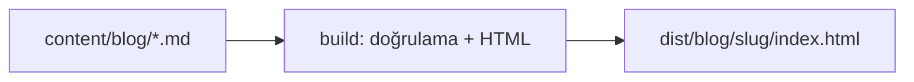

Bu dosya bir **taslaktır** ve hiçbir zaman yayımlanmaz. Yazı sayfasının tüm öğelerini
yerelde görmek için `npm run dev:drafts` ile açılır. Buradaki örnekler yalnızca
biçimi gösterir; gerçek bir deneyim veya ölçüm değildir.

## Başlıklar ve içindekiler

`##` ve `###` başlıkları otomatik olarak içindekiler listesine eklenir ve her birinin
bağlantısı olur. Gövdede `#` (h1) kullanılmaz; sayfa başlığı frontmatter'daki `title`
alanından gelir.

### Alt başlık örneği

Önerilen ama zorunlu olmayan bölümler: Problem / hedef, Mimari, Uygulama, Karşılaşılan
hatalar, Hatanın nedeni, Çözüm, Sonuç / öğrenilenler.

## Kod blokları

Dil etiketi verilen bloklar build sırasında renklendirilir. `title="..."` ile dosya adı
gösterilebilir:

```ts title="vite.config.ts"
import { defineConfig } from 'vite';

export default defineConfig({
  plugins: [],
});
```

Uzun satırlar mobilde sayfayı taşırmaz, blok kendi içinde yatay kayar:

```bash
echo "bu satır bilerek uzun tutuldu; küçük ekranda kod bloğunun kendi içinde yatay kaydırıldığını göstermek için yazıldı"
```

### Terminal ve çıktı

`console` veya `terminal` etiketi komut + çıktı içeren oturumlar, `output` yalnızca çıktı
içindir:

```console
$ node -v
<komutun gerçek çıktısı buraya>
```

```output
<yalnızca çıktı örneği>
```

## Tablo

| Alan          | Zorunlu        | Açıklama                    |
| ------------- | -------------- | --------------------------- |
| `title`       | evet           | Sayfa başlığı               |
| `date`        | yayında evet   | YYYY-AA-GG                  |
| `draft`       | evet           | `true` ise yayımlanmaz      |

## Alıntı ve bağlantı

> Alıntılar ince bir sol çizgiyle gösterilir.

Dış bağlantılar yeni sekmede açılır: [GitHub](https://github.com/cemozcelikkk).
İç bağlantılar sayfa yenilemeden açılır: [Projeler](/projeler).

## Görsel

Görseller `public/` altına konup kök yoldan verilir. Başlıktaki tırnaklı metin açıklama
olarak gösterilir:


## Diyagram


